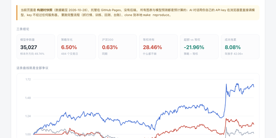
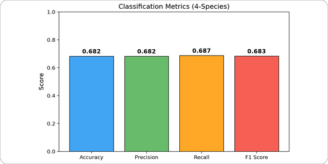
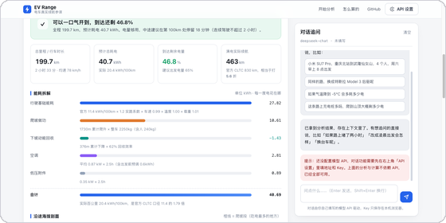
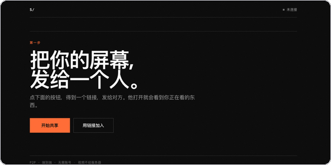
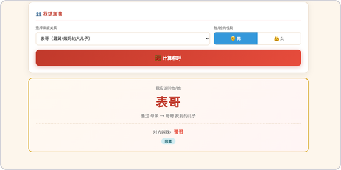

  
  &nbsp;
  

### About

I build systems end to end: data cleaning, model training, and the packaging that lets someone else actually open and use the result.

In 2026 I worked on defect detection and yield analysis at BOE's B8 plant in Chongqing. The part that mattered was not model accuracy but the re-inspection rate the line was willing to accept. That is what I work on now: getting AI into places where people use it, with a fallback for when it is wrong.

---

### Selected Projects

<table>
<tr>
<td width="50%" valign="top">
  
   
  <b><a href="https://github.com/Leruo212/stock-quant-agent">stock-quant-agent</a></b>
   
  <code>PyTorch</code> <code>LLM Agent</code> <code>Quant research</code>
    
  <b>A quant workbench that publishes its own negative result.</b>
   
  Daily-frequency research stack for the CSI 300: CNN-LSTM-Attention baseline plus an LLM forecasting agent, three-tier data fallback, backtesting against three benchmarks, IC and decile analysis, and a ledger of every live prediction. Ships with the full negative result (49.74% directional accuracy, indistinguishable from baseline) and the price-volume backtest that replaced it.
   
  → <a href="https://leruo212.github.io/stock-quant-agent/">Live demo</a> · <a href="https://github.com/Leruo212/stock-quant-agent">Source</a>
</td>
<td width="50%" valign="top">
  
   
  <b><a href="https://github.com/Leruo212/dna-ssl-project">dna-ssl-project</a></b>
   
  <code>PyTorch</code> <code>Self-supervised</code> <code>Bioinformatics</code>
    
  <b>A failure traced to its root, then written up.</b>
   
  Masked-reconstruction pretraining of a CNN encoder, transferred to four-species classification (0.68 validation accuracy against a 0.25 chance baseline). Ships with full training logs, PCA and t-SNE plots, and a step-by-step post-mortem on why the classification head sat at chance level.
   
  → <a href="https://github.com/Leruo212/dna-ssl-project">Source and post-mortem</a>
</td>
</tr>
<tr>
<td colspan="2">&nbsp;</td>
</tr>
<tr>
<td width="50%" valign="top">
  
   
  <b><a href="https://github.com/Leruo212/ev-range-agent">ev-range-agent</a></b>
   
  <code>Vanilla JS</code> <code>LLM Agent</code> <code>Zero dependency</code>
    
  <b>Climbs cost m·g·Δh; descents return 62%.</b>
   
  An EV range advisor that pulls real road networks, cumulative ascent (not net elevation), en-route weather and a 51-model catalogue, then accounts for every kWh. Pure static, zero dependencies, zero build step, no API keys required.
   
  → <a href="https://leruo212.github.io/ev-range-agent/">Live demo</a> · <a href="https://github.com/Leruo212/ev-range-agent">Source</a>
</td>
<td width="50%" valign="top">
  
   
  <b><a href="https://github.com/Leruo212/screenshare-p2p">screenshare-p2p</a></b>
   
  <code>WebRTC</code> <code>PeerJS</code> <code>Vanilla JS</code>
    
  <b>Screen sharing with no server.</b>
   
  Send the link and the other side sees your screen. Twelve-character room codes (62¹² combinations), signalling through a public broker, video connected peer to peer, hosted as a static site at no cost.
   
  → <a href="https://leruo212.github.io/screenshare-p2p/screenshare.html">Open</a> · <a href="https://github.com/Leruo212/screenshare-p2p">Source</a>
</td>
</tr>
<tr>
<td colspan="2">&nbsp;</td>
</tr>
<tr>
<td width="50%" valign="top">
  
   
  <b><a href="https://github.com/Leruo212/boe-growth-agent">boe-growth-agent</a></b>
   
  <code>React 19</code> <code>Express 5</code> <code>Coze API</code>
    
  <b>Say what you did; get the weekly report.</b>
   
  A conversational work-log assistant that turns a spoken summary into structured daily, weekly, monthly, quarterly or yearly reports. Front end and back end separated, with a local fallback when no API is configured.
   
  → <a href="https://github.com/Leruo212/boe-growth-agent">Source</a>
</td>
<td width="50%" valign="top">
  
   
  <b><a href="https://github.com/Leruo212/chinese-relative-title-calculator">chinese-relative-title-calculator</a></b>
   
  <code>Python</code> <code>Zero dependency</code>
    
  <b>What do I call my father's cousin's daughter?</b>
   
  Chinese kinship term calculator covering direct, paternal, maternal, sibling and in-law relations. Zero-dependency Python.
   
  → <a href="https://github.com/Leruo212/chinese-relative-title-calculator">Source</a>
</td>
</tr>
</table>

---

### Tech Stack

| | |
|---|---|
| **Languages** | Python · JavaScript / TypeScript · SQL |
| **Modelling** | PyTorch · CNN / Transformer · self-supervised representation learning |
| **Evaluation** | backtesting and benchmark comparison · IC / decile analysis · LLM prediction ledger |
| **Application** | RAG · MCP · Agent · React · Node.js |

---

### Contact

📮 <a href="mailto:m4rh0zen@foxmail.com">m4rh0zen@foxmail.com</a>

Read this in <a href="README.md">中文</a>

