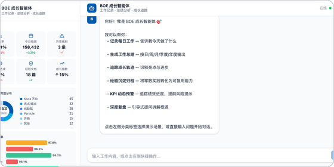

  
  &nbsp;
  

### About

I build systems end to end: data cleaning, model training, and the packaging that lets someone else actually open and use the result.

In 2026 I worked on defect detection and yield analysis at BOE's B8 plant in Chongqing. The part that mattered was not model accuracy but the re-inspection rate the line was willing to accept. That is what I work on now: getting AI into places where people use it, with a fallback for when it is wrong.

---

### Selected Projects

<table>
<tr>
<td width="50%" valign="top">
  
   
  <b><a href="https://github.com/Leruo212/stock-quant-agent">stock-quant-agent</a></b>
   
  <code>PyTorch</code> <code>LLM Agent</code> <code>Quant research</code>
    
  A daily-frequency quant research workbench for the CSI 300. CNN-LSTM-Attention baseline plus an LLM forecasting agent, three-tier data fallback, backtesting against three benchmarks, IC and decile analysis, and a ledger that records every live prediction. Runs in the browser with your own API key.
   
  → <a href="https://leruo212.github.io/stock-quant-agent/">Live demo</a>
</td>
<td width="50%" valign="top">
  
   
  <b><a href="https://github.com/Leruo212/dna-ssl-project">dna-ssl-project</a></b>
   
  <code>PyTorch</code> <code>Self-supervised</code> <code>Bioinformatics</code>
    
  Masked-reconstruction pretraining of a CNN encoder on unlabelled genomic fragments, transferred to four-species classification. Ships with full training logs, t-SNE plots, and a post-mortem that traces a failure to its root.
</td>
</tr>
<tr>
<td colspan="2">&nbsp;</td>
</tr>
<tr>
<td width="50%" valign="top">
  
   
  <b><a href="https://github.com/Leruo212/ev-range-agent">ev-range-agent</a></b>
   
  <code>Vanilla JS</code> <code>LLM Agent</code> <code>Zero dependency</code>
    
  An EV range advisor. Give it a model, passenger count, origin and destination; it pulls real road networks, elevation and en-route weather, then accounts for every kWh, including what a climb costs and what a descent returns.
   
  → <a href="https://leruo212.github.io/ev-range-agent/">Live demo</a>
</td>
<td width="50%" valign="top">
  
   
  <b><a href="https://github.com/Leruo212/screenshare-p2p">screenshare-p2p</a></b>
   
  <code>WebRTC</code> <code>PeerJS</code> <code>Vanilla JS</code>
    
  Peer-to-peer screen sharing in the browser with no server of your own. Send the link and the other side sees your screen. Signalling goes through a public broker; the video connects directly.
   
  → <a href="https://leruo212.github.io/screenshare-p2p/screenshare.html">Open</a>
</td>
</tr>
<tr>
<td colspan="2">&nbsp;</td>
</tr>
<tr>
<td width="50%" valign="top">
  
   
  <b><a href="https://github.com/Leruo212/boe-growth-agent">boe-growth-agent</a></b>
   
  <code>React 19</code> <code>Express 5</code> <code>Coze API</code>
    
  A conversational work-log assistant. Say what you did today; it becomes a structured daily, weekly, monthly, quarterly or yearly report.
</td>
<td width="50%" valign="top">
  
   
  <b><a href="https://github.com/Leruo212/chinese-relative-title-calculator">chinese-relative-title-calculator</a></b>
   
  <code>Python</code> <code>Zero dependency</code>
    
  Chinese kinship term calculator. What do I call my father's cousin's daughter? It gives you a straight answer.
</td>
</tr>
</table>

---

### Tech Stack

| | |
|---|---|
| **Languages** | Python · JavaScript / TypeScript · SQL |
| **Modelling** | PyTorch · CNN / Transformer · self-supervised representation learning |
| **Evaluation** | backtesting and benchmark comparison · IC / decile analysis · LLM prediction ledger |
| **Application** | RAG · MCP · Agent · React · Node.js |

---

### Contact

📮 <a href="mailto:m4rh0zen@foxmail.com">m4rh0zen@foxmail.com</a>
