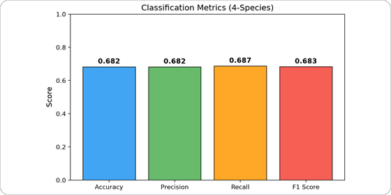
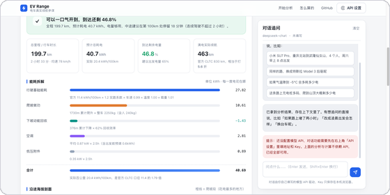
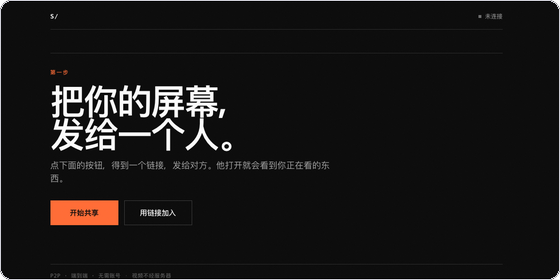
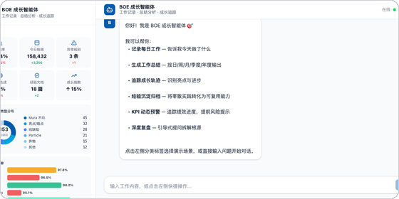
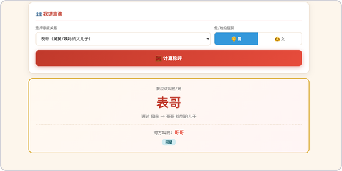

  
  &nbsp;
  

### 关于

算法工程。习惯把一件事做完整：从数据清洗、模型训练，一路到打包成别人能直接点开用的东西。

2026 年在京东方重庆 B8 做缺陷检测与良率分析，把模型判定的准确率变成了产线敢用的复判率。现在专注 AI 应用的落地与评测：一个模型跑通不算完，得有人愿意用、错了有人兜底，才算完。

---

### 精选项目

<table>
<tr>
<td width="50%" valign="top">
  
   
  <b><a href="https://github.com/Leruo212/stock-quant-agent">stock-quant-agent</a></b>
   
  <code>PyTorch</code> <code>LLM Agent</code> <code>量化研究</code>
    
  <b>连「模型没用」也写进 README 的量化工作台。</b>
   
  沪深300 日频。CNN-LSTM-Attention 基线 + LLM 预测 Agent，配三级容错取数、三基准回测、IC 与分层检验、预测台账。附一条完整负结果（方向准确率 49.74%，与基线无差异）和之后改用量价信号的回测。
   
  → <a href="https://leruo212.github.io/stock-quant-agent/">在线体验</a> · <a href="https://github.com/Leruo212/stock-quant-agent">源码</a>
</td>
<td width="50%" valign="top">
  
   
  <b><a href="https://github.com/Leruo212/dna-ssl-project">dna-ssl-project</a></b>
   
  <code>PyTorch</code> <code>自监督学习</code> <code>生物信息</code>
    
  <b>把一次失败查到根上，再写成复盘。</b>
   
  掩码重构预训练 CNN 编码器，迁移到四物种分类（验证集 0.68，随机基线 0.25）。附完整训练日志、PCA / t-SNE，以及「分类头为什么停在随机水平」的逐项定位过程。
   
  → <a href="https://github.com/Leruo212/dna-ssl-project">源码与复盘</a>
</td>
</tr>
<tr>
<td colspan="2">&nbsp;</td>
</tr>
<tr>
<td width="50%" valign="top">
  
   
  <b><a href="https://github.com/Leruo212/ev-range-agent">ev-range-agent</a></b>
   
  <code>Vanilla JS</code> <code>LLM Agent</code> <code>零依赖</code>
    
  <b>爬坡按 m·g·Δh 算，下坡按 62% 回收。</b>
   
  电车续航参谋。真实路网 + 累计爬升（不是净海拔差）+ 沿途天气 + 51 款车型库，把每度电花在哪儿逐项拆开。纯静态零依赖、零构建，数据源全免 Key。
   
  → <a href="https://leruo212.github.io/ev-range-agent/">在线体验</a> · <a href="https://github.com/Leruo212/ev-range-agent">源码</a>
</td>
<td width="50%" valign="top">
  
   
  <b><a href="https://github.com/Leruo212/screenshare-p2p">screenshare-p2p</a></b>
   
  <code>WebRTC</code> <code>PeerJS</code> <code>Vanilla JS</code>
    
  <b>没有服务器的屏幕共享。</b>
   
  把链接发给对方，点开就能看。12 位房间号（62¹² 组合），信令只走公共 broker，画面端到端直连；纯静态托管，不花一分钱服务器。
   
  → <a href="https://leruo212.github.io/screenshare-p2p/screenshare.html">在线打开</a> · <a href="https://github.com/Leruo212/screenshare-p2p">源码</a>
</td>
</tr>
<tr>
<td colspan="2">&nbsp;</td>
</tr>
<tr>
<td width="50%" valign="top">
  
   
  <b><a href="https://github.com/Leruo212/boe-growth-agent">boe-growth-agent</a></b>
   
  <code>React 19</code> <code>Express 5</code> <code>Coze API</code>
    
  <b>随口说一句，自动变成周报。</b>
   
  对话式工作记录助手：说清今天做了什么，它整理成日 / 周 / 月 / 季 / 年结构化报告。前后端分离，未配置 API 时走本地降级。
   
  → <a href="https://github.com/Leruo212/boe-growth-agent">源码</a>
</td>
<td width="50%" valign="top">
  
   
  <b><a href="https://github.com/Leruo212/chinese-relative-title-calculator">chinese-relative-title-calculator</a></b>
   
  <code>Python</code> <code>零依赖</code>
    
  <b>「我爸的表哥的女儿」到底该叫什么。</b>
   
  覆盖直系、父系旁亲、母系旁亲、同辈、配偶亲属五类关系，输入称呼路径直接给出结论。零依赖 Python。
   
  → <a href="https://github.com/Leruo212/chinese-relative-title-calculator">源码</a>
</td>
</tr>
</table>

---

### 技术栈

| | |
|---|---|
| **语言** | Python · JavaScript / TypeScript · SQL |
| **建模** | PyTorch · CNN / Transformer · 自监督表示学习 |
| **评测** | 回测与基准对照 · IC / 分层分析 · LLM 预测台账 |
| **应用** | RAG · MCP · Agent · React · Node.js |

---

### 联系

📮 <a href="mailto:m4rh0zen@foxmail.com">m4rh0zen@foxmail.com</a>

Read this in <a href="README.en.md">English</a>

