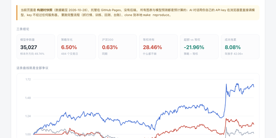

  
  &nbsp;
  

---

## 中文版

### 关于

算法工程。习惯把一件事做完整：从数据清洗、模型训练，一路到打包成别人能直接点开用的东西。

2026 年在京东方重庆 B8 做缺陷检测与良率分析，把模型判定的准确率变成了产线敢用的复判率。现在专注 AI 应用的落地与评测：一个模型跑通不算完，得有人愿意用、错了有人兜底，才算完。

---

### 精选项目

<table>
<tr>
<td width="50%" valign="top">
  
   
  <b><a href="https://github.com/Leruo212/stock-quant-agent">stock-quant-agent</a></b>
   
  <code>PyTorch</code> <code>LLM Agent</code> <code>量化研究</code>
    
  沪深300 日频量化研究工作台。CNN-LSTM-Attention 基线模型 + 大模型预测 Agent，配三级容错取数、三基准回测、IC 与分层检验，以及一套记录每次真实预测的台账。自带 API key 即可在浏览器里直接对话。
   
  → <a href="https://leruo212.github.io/stock-quant-agent/">在线体验</a>
</td>
<td width="50%" valign="top">
  
   
  <b><a href="https://github.com/Leruo212/dna-ssl-project">dna-ssl-project</a></b>
   
  <code>PyTorch</code> <code>自监督学习</code> <code>生物信息</code>
    
  用掩码重构在未标注的基因组片段上预训练 CNN 编码器，再迁移到四物种分类。附完整训练日志、t-SNE 可视化，以及一份把失败原因查到根上的复盘。
</td>
</tr>
<tr>
<td colspan="2">&nbsp;</td>
</tr>
<tr>
<td width="50%" valign="top">
  
   
  <b><a href="https://github.com/Leruo212/ev-range-agent">ev-range-agent</a></b>
   
  <code>Vanilla JS</code> <code>LLM Agent</code> <code>零依赖</code>
    
  电车真实续航参谋。给出车型、人数、出发地与目的地，自动拉取真实路网、地形海拔和沿途天气，把每一度电花在哪儿算清楚 —— 尤其是爬坡多耗的、下坡回收的。
   
  → <a href="https://leruo212.github.io/ev-range-agent/">在线体验</a>
</td>
<td width="50%" valign="top">
  
   
  <b><a href="https://github.com/Leruo212/screenshare-p2p">screenshare-p2p</a></b>
   
  <code>WebRTC</code> <code>PeerJS</code> <code>Vanilla JS</code>
    
  浏览器点对点屏幕共享，不需要任何云服务器。把链接发给对方，点开就能看 —— 信令只走公共 broker，画面端到端直连。
   
  → <a href="https://leruo212.github.io/screenshare-p2p/screenshare.html">在线入口</a>
</td>
</tr>
<tr>
<td colspan="2">&nbsp;</td>
</tr>
<tr>
<td width="50%" valign="top">
  
   
  <b><a href="https://github.com/Leruo212/boe-growth-agent">boe-growth-agent</a></b>
   
  <code>React 19</code> <code>Express 5</code> <code>Coze API</code>
    
  对话式工作记录助手。随口说一句今天做了什么，自动整理成日 / 周 / 月 / 季 / 年结构化报告。
</td>
<td width="50%" valign="top">
  
   
  <b><a href="https://github.com/Leruo212/chinese-relative-title-calculator">chinese-relative-title-calculator</a></b>
   
  <code>Python</code> <code>零依赖</code>
    
  中国亲戚称呼推算 —— 「我爸爸的表哥的女儿我该叫什么」，算个准话。
</td>
</tr>
</table>

---

### 技术栈

| | |
|---|---|
| **语言** | Python · JavaScript / TypeScript · SQL |
| **建模** | PyTorch · CNN / Transformer · 自监督表示学习 |
| **评测** | 回测与基准对照 · IC / 分层分析 · LLM 预测台账 |
| **应用** | RAG · MCP · Agent · React · Node.js |

---

### 联系

📮 <a href="mailto:m4rh0zen@foxmail.com">m4rh0zen@foxmail.com</a>

 

## English

### About

I build systems end to end: data cleaning, model training, and the packaging that lets someone else actually open and use the result.

In 2026 I worked on defect detection and yield analysis at BOE's B8 plant in Chongqing. The part that mattered was not model accuracy but the re-inspection rate the line was willing to accept. That is what I work on now: getting AI into places where people use it, with a fallback for when it is wrong.

---

### Selected Projects

**[stock-quant-agent](https://github.com/Leruo212/stock-quant-agent)** · `PyTorch` `LLM Agent`
A daily-frequency quant research workbench for the CSI 300. CNN-LSTM-Attention baseline plus an LLM forecasting agent, three-tier data fallback, backtesting against three benchmarks, IC and decile analysis, and a ledger that records every live prediction. Runs in the browser with your own API key. → [Live demo](https://leruo212.github.io/stock-quant-agent/)

**[dna-ssl-project](https://github.com/Leruo212/dna-ssl-project)** · `PyTorch` `Self-supervised`
Masked-reconstruction pretraining of a CNN encoder on unlabelled genomic fragments, transferred to four-species classification. Ships with full training logs, t-SNE plots, and a post-mortem that traces a failure to its root.

**[ev-range-agent](https://github.com/Leruo212/ev-range-agent)** · `Vanilla JS` `LLM Agent`
An EV range advisor. Give it a model, passenger count, origin and destination; it pulls real road networks, elevation and en-route weather, then accounts for every kWh, including what a climb costs and what a descent returns. → [Live demo](https://leruo212.github.io/ev-range-agent/)

**[screenshare-p2p](https://github.com/Leruo212/screenshare-p2p)** · `WebRTC` `PeerJS`
Peer-to-peer screen sharing in the browser with no server of your own. Send the link and the other side sees your screen. Signalling goes through a public broker; the video connects directly. → [Open](https://leruo212.github.io/screenshare-p2p/screenshare.html)

**[boe-growth-agent](https://github.com/Leruo212/boe-growth-agent)** · `React 19` `Express 5` `Coze API`
A conversational work-log assistant. Say what you did today; it becomes a structured daily, weekly, monthly, quarterly or yearly report.

**[chinese-relative-title-calculator](https://github.com/Leruo212/chinese-relative-title-calculator)** · `Python`
Chinese kinship term calculator. What do I call my father's cousin's daughter? It gives you a straight answer.

---

### Tech Stack

| | |
|---|---|
| **Languages** | Python · JavaScript / TypeScript · SQL |
| **Modelling** | PyTorch · CNN / Transformer · self-supervised representation learning |
| **Evaluation** | backtesting and benchmark comparison · IC / decile analysis · LLM prediction ledger |
| **Application** | RAG · MCP · Agent · React · Node.js |

---

### Contact

📮 <a href="mailto:m4rh0zen@foxmail.com">m4rh0zen@foxmail.com</a>

<a href="#中文版">↑ 返回中文版</a> &nbsp;·&nbsp; <a href="#top">↑ Back to top</a>

